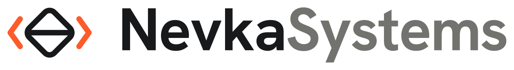

  <picture>
    <source media="(prefers-color-scheme: dark)" srcset="./profile/assets/wordmark-dark.svg">
    <source media="(prefers-color-scheme: light)" srcset="./profile/assets/wordmark-light.svg">
    
  </picture>

<h3 align="center">Software built around your world.</h3>

  Product design and software engineering for education, AI and fintech.

  <a href="https://nevkasystems.com/">Website</a> ·
  <a href="https://nevkasystems.com/contact">Start a conversation</a> ·
  <a href="mailto:info@nevkasystems.com">Email</a>

---

### What we build

- **[Education](https://nevkasystems.com/education)** — Learning platforms, assessment tools and academy operations.
- **[AI software](https://nevkasystems.com/ai)** — Knowledge search, document processing and assisted workflows.
- **[Fintech](https://nevkasystems.com/fintech)** — Accounts, payments, financial records and operations workspaces.

### How we work

We help teams shape a product, design the experience, build and test the software, and prepare it for release. Clear scope, regular feedback and documented decisions keep the work understandable.

Our work includes new products, improvements to existing platforms, integrations and ongoing support.

### Build with us

Tell us what you want to create or improve.

**[nevkasystems.com](https://nevkasystems.com/)** · **[info@nevkasystems.com](mailto:info@nevkasystems.com)**
