 

We work with you from the first product decisions through development, release and ongoing improvements.

**Discover → Design → Build → Launch → Evolve**

  Product design and software engineering for <b>education</b>, <b>AI</b> and <b>fintech</b>.

## Explore what we build

  
  
  
  

 

The product’s requirements shape the stack. We plan the experience, integrations and day-to-day operation together.

- **Clear decisions:** scope, architecture and priorities you can review.
- **Visible progress:** working software, testing and regular feedback.
- **A considered handover:** documentation, source code and agreed account access.

## Build with NevkaSystems

Tell us about the product you want to create or the platform you want to improve.

  
  

[nevkasystems.com](https://nevkasystems.com/) · [info@nevkasystems.com](mailto:info@nevkasystems.com)
